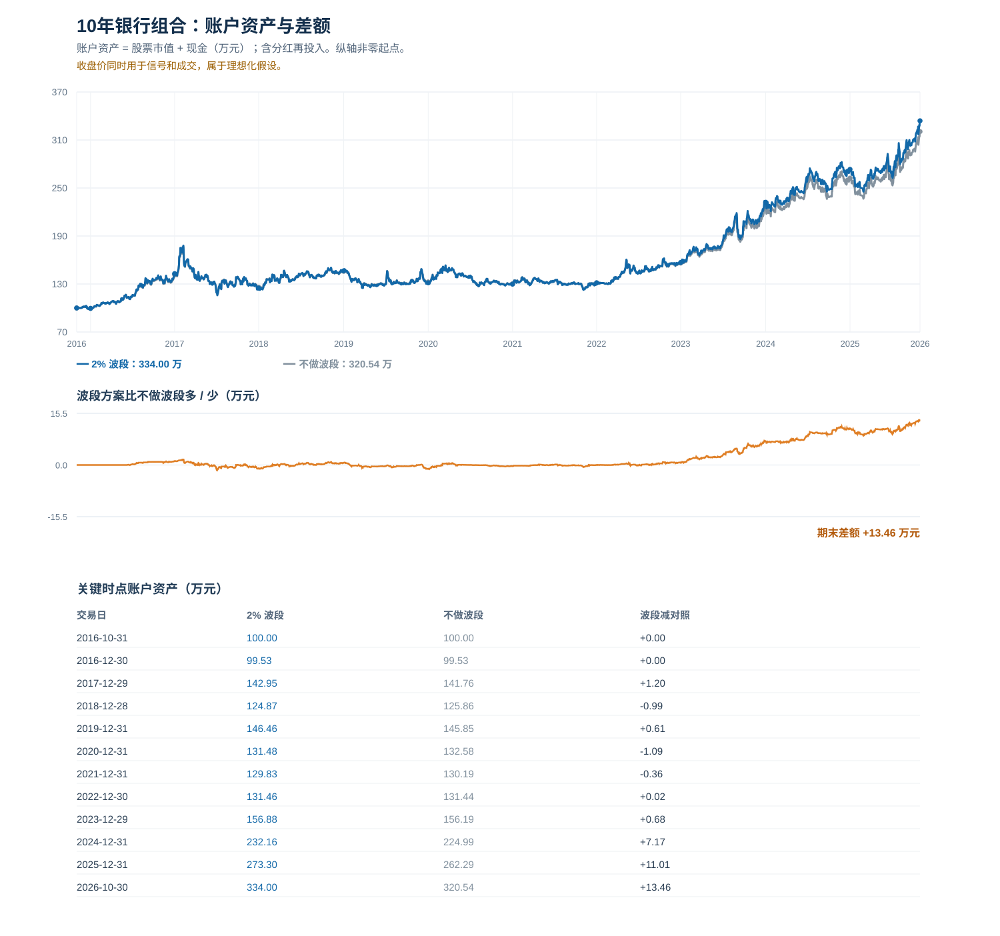
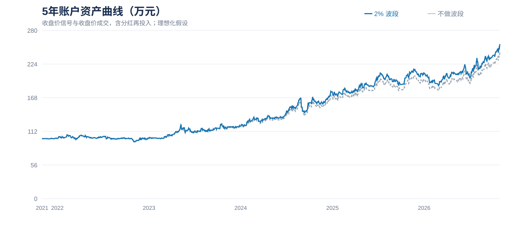
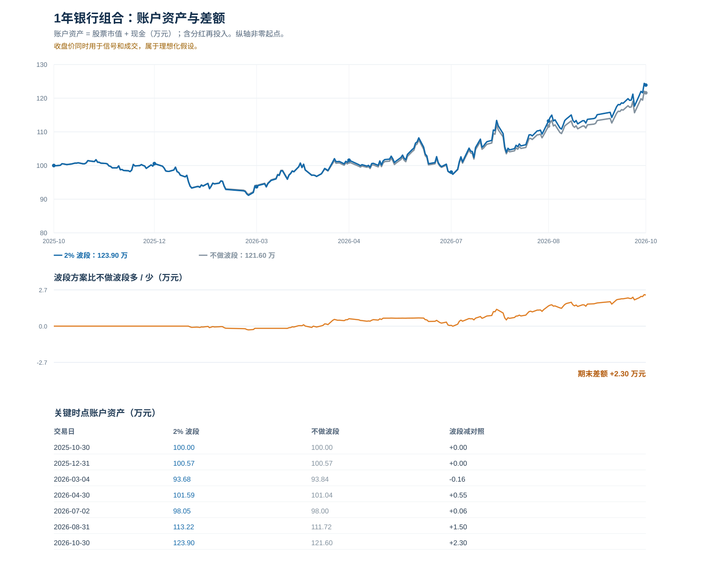

# 银行股分红与小额波段策略

本方案以长期持有和分红再投入为主，用初始资金的一小部分尝试波段。推荐先观察 ±2% 开关；它在本次比较中收益较高，但样本有限，不能认定为长期最优。

**回测使用当日最终收盘价产生信号，并假设以同一收盘价成交。14:59 尚不知道最终收盘价，这个回测存在未来信息，只能作为理想化估算，不能当作真实的 14:59 收益。**

## 完整策略

- 标的：工商银行 A 股（601398）和建设银行 A 股（601939）。
- 资金：假设初始 100 万元，90 万元建长期仓，10 万元设为波段资金。两个部分只用于记账，证券账户仍按实际持股和先进先出计算税款。
- 建仓：十个交易周内每周买一次，交替买入两只股票，每次预算 9 万元，目标各投入约 45 万元。成交金额和费用合计不超过单次预算，买入按 100 股整数倍取整。
- 分红：现金分红用于买入长期仓市值较小的银行股，单次最高为总资产的 5%，且不超过可用于再投资的现金。优先使用本周波段买入额度，未使用时再投入分红；不足 100 股的资金留待下一次。
- 波段信号：收盘前参考当日价格相对于前收盘价的涨跌幅，涨幅超过 2% 卖出，跌幅超过 2% 买入；除息日使用交易所公布的除权除息参考价。恰好等于 2% 不触发。
- 交易大小：单次上限为账户总资产的 5%；波段现金不足或波段可卖股数不足时，可以按实际可用数量交易，但必须满足最小交易单位。波段买卖的盈亏留在波段资金中，不每日强行调整为总资产的 10%。
- 底仓：逻辑上只卖出累计波段买入、尚未卖出的股数，长期仓不主动减持。初始波段持仓为零，若先遇到上涨信号，则不卖出。
- 频率：两只股票合计，每个自然交易周最多买入一次、卖出一次。分红再投入和建仓也占用买入次数。两只股票同日都有信号时，回测只处理涨跌幅绝对值较大的那只；该方向的次数已用完或资金、股数不足时，该信号失效，不转给另一只。

10 万元是初始划出的波段资金，不是任何时点必须保留的现金下限。波段买入后现金可低于 10 万元，卖出后可增加；两只银行股票价格变化后，长期仓市值也不会持续精确各占 45%。买卖按 ±2% 信号执行不保证每笔盈利或降低成本。

### 收盘前怎样操作

每天交易时段临近收盘时检查两只股票、当周已用交易次数、波段现金和可卖波段股数。按当前上交所规则，14:57—15:00 是收盘集合竞价阶段，可申报但不能撤单；14:59 可参考集合竞价虚拟参考价，最终收盘价和是否成交仍未确定。[上交所交易规则](https://www.sse.com.cn/lawandrules/sselawsrules2025/stocks/exchange/c/c_20260424_10816482.shtml)

此目录的脚本只复现历史回测，不连接券商、不监控实时行情，也不自动下单。若使用券商提醒，可减少手动盯盘，但需要自行检查提醒时点、触发规则和是否收到提醒。

## 需要操作多久一次

以下统计来自 2% 理想化收盘价回测，排除开始的十周建仓；“下单日”包括波段交易和分红再投入，同一天多笔只算一天。

| 样本 | 建仓结束后下单日 | 波段交易笔数 | 分红再投入笔数 | 平均下单日 |
|---|---:|---:|---:|---:|
| 十年样本：2017-01-03 建仓结束后 | 188 天 | 163 笔 | 27 笔 | 每月约 1.6 天 |
| 五年样本：2022-01-04 建仓结束后 | 91 天 | 77 笔 | 16 笔 | 每月约 1.6 天 |
| 一年样本：2025-12-29 建仓结束后 | 24 天 | 21 笔 | 4 笔 | 每月约 2.4 天 |

十年样本中，建仓后的 503 个自然交易周里，162 周至少有一天发生交易，约占 32%。上述是历史平均而非固定间隔；无自动提醒时，即使不下单，也需要在每个交易日检查是否有信号。建仓阶段每周约需操作一次。

## 资金曲线与收益

初始 100 万元，按各区间起点重新建仓，截至 2026 年 10 月 30 日。期末资产等于股票市值加现金，已包含收到的分红，不能再把累计分红加一次。

| 2% 策略区间 | 起始交易日 | 期末资产 | 累计收益 | 年化收益 | 最大回撤 |
|---|---|---:|---:|---:|---:|
| 十年 | 2016-10-31 | 334.00 万元 | 234.00% | 12.82% | -34.90% |
| 五年 | 2021-11-01 | 255.92 万元 | 155.92% | 20.70% | -14.84% |
| 一年 | 2025-10-30 | 123.90 万元 | 23.90% | 约 23.92% | -10.40% |







十年曲线中，账户在 2018 年 2 月 5 日至 2018 年 7 月 2 日经历最大回撤，幅度约 34.90%。从同一十年账户的年末资产计算，2018 年约 -12.65%、2020 年约 -10.23%、2021 年约 -1.26%；2024 年约 +47.99%。2026 年数据截至 10 月 30 日，并非全年。十年收益的相当部分来自后期上涨，历史年化不应按每年稳定到账理解。

## 开关比较

| 日涨跌幅开关 | 十年期末资产 | 五年期末资产 | 一年期末资产 |
|---|---:|---:|---:|
| 不做波段，只持有并再投入分红 | 320.54 万元 | 242.27 万元 | 121.60 万元 |
| 1% | 326.39 万元 | 250.26 万元 | 121.92 万元 |
| 1.5% | 331.38 万元 | 254.07 万元 | 123.38 万元 |
| **2%** | **334.00 万元** | **255.92 万元** | **123.90 万元** |
| 2.5% | 328.00 万元 | 250.76 万元 | 122.17 万元 |
| 3% | 332.62 万元 | 252.42 万元 | 122.62 万元 |

十年样本中，2% 波段买卖共 163 笔，1% 共 400 笔。2% 的交易较少，本次三个区间的期末资产也较高，可作为初始观察参数；三个区间互相重叠，且两只股票与参数是事后选定，不能据此证明该参数未来有效。

不做波段的对照同样分红再投入，但初始 10 万元波段资金一直留在现金。波段策略部分时间将这笔资金投入股票，两组股票敞口不同，期末差额不能全部归因于择时。

## 数据与成本口径

- 行情使用腾讯财经不复权日线，股息使用东方财富分红记录：[工商银行](https://data.eastmoney.com/yjfp/detail/601398.html)、[建设银行](https://data.eastmoney.com/yjfp/detail/601939.html)。数据文件是固定快照，最后交易日为 2026-10-30，脚本不会自动更新行情。
- 除息日按前收盘价减每股现金分红计算参考价，并按分计算。回测假设符合登记日条件的股息在除息日到账，实际到账时间以公告和券商记录为准。
- 佣金假设为成交额的 0.03%，单笔最低 5 元；过户费假设为成交额的 0.001%；卖出印花税在 2023-08-28 前按 0.1%，之后按 0.05%。实际券商费用可能不同。
- 按个股实际持仓批次先进先出估算已卖出股份的股息税，期末未卖股份可能产生的税未计入。[股息税政策](https://www.chinatax.gov.cn/n810341/n810755/c1797427/content.html)
- 所有交易假定按最终收盘价成交、没有额外滑点；不计现金利息、盘口流动性、涨跌停和委托未成交。实际结果可能不同。
- 个股集中于银行业，股价、分红政策与经营状况均可能变化。历史曲线不能保证未来收益。

## 复现

需要 Python 3，使用标准库即可。在仓库根目录运行：

```powershell
python bank_dividend/backtest.py
python bank_dividend/analyze.py
python bank_dividend/test_backtest.py
```

回测汇总、逐日资产、交易明细与 SVG 曲线位于 `bank_dividend/results/`。`backtest.py` 会重新生成相关 CSV，`analyze.py` 会生成曲线并打印操作频率与年度收益。数据、脚本与结果均不包含实时行情或自动交易功能。
